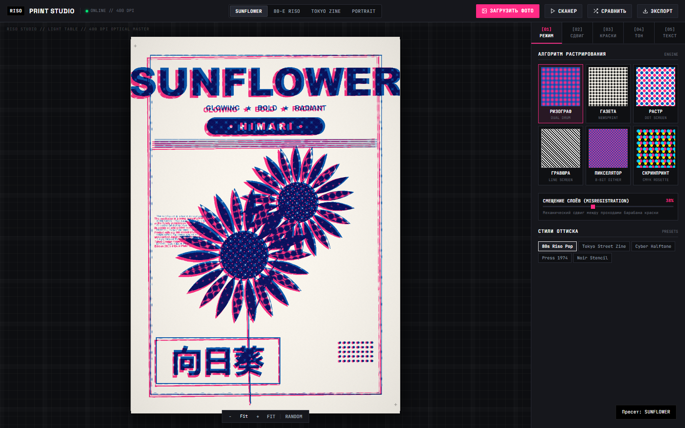

# RISO // Digital Stencil Duplicator & Risograph Studio

> Аутентичный онлайн-генератор эффекта ризографии, полутонового растра (halftone), механического смещения слоёв (misregistration) и ретро-печати 80-х годов. Готов к работе в браузере и как **Telegram Mini App (TMA)**.



## 🌟 Возможности (Features)

- **Физическая модель Ризографа (RISO Kagaku):**
  - Разделение на барабаны соевых чернил (*Fluorescent Pink*, *Federal Blue*, *Sunflower Yellow*, *Riso Black*, *Bright Red*, *Medium Teal*).
  - Настоящее субтрактивное смешивание слоёв (*Multiply Overprint*).
  - Смещение слоёв (*Misregistration / Layer Shift*) с регулировкой по X/Y и микро-поворотом барабана.
- **Геометрия растра (Screening):**
  - Классические полутоновые точки (*Halftone Rosettes* без муара).
  - Линейный растр (*Engraving / Woodcut*).
  - 8-битный дизеринг Байера (*Pixelator / Dither*).
  - CMYK многослойный скринпринт.
- **Интеграция с Веб-камерой:**
  - Быстрый снимок прямо из браузера.
  - Живой режим (*Live 60 FPS GPU Stream*) — видеопоток с камеры транслируется через шейдер в реальном времени.
- **Telegram Mini App:**
  - Поддержка Telegram WebApp SDK.
  - Адаптивный мобильный интерфейс и кнопка «В чат / Сохранить».
- **Экспорт:**
  - PNG высокого разрешения (до 300 DPI / 4000px).
  - Оптимизированный JPG.
  - Копирование оттиска в буфер обмена.
  - Запись видео анимации сканера (*WebM*).

## 🚀 Запуск локально

Просто откройте `index.html` в любом браузере или запустите локальный сервер:

```bash
# Python
python -m http.server 8085

# Node.js
npx serve .
```

## 📱 Запуск как Telegram Mini App

1. Опубликуйте репозиторий на **GitHub Pages** (Settings -> Pages -> Branch: `main` -> Save) или на **Vercel / Cloudflare**.
2. В Telegram откройте `@BotFather` и создайте Mini App через команду `/newapp`.
3. Укажите полученный HTTPS-адрес.
4. Готово! Теперь ваш ризограф открывается прямо внутри Telegram.

---
Лицензия: MIT
